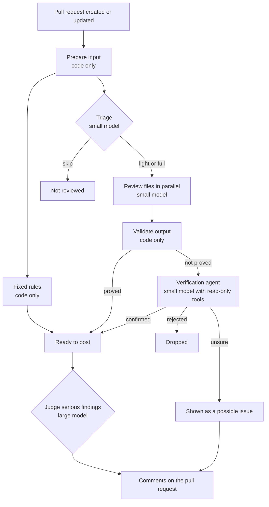
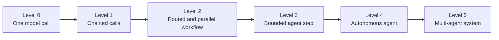
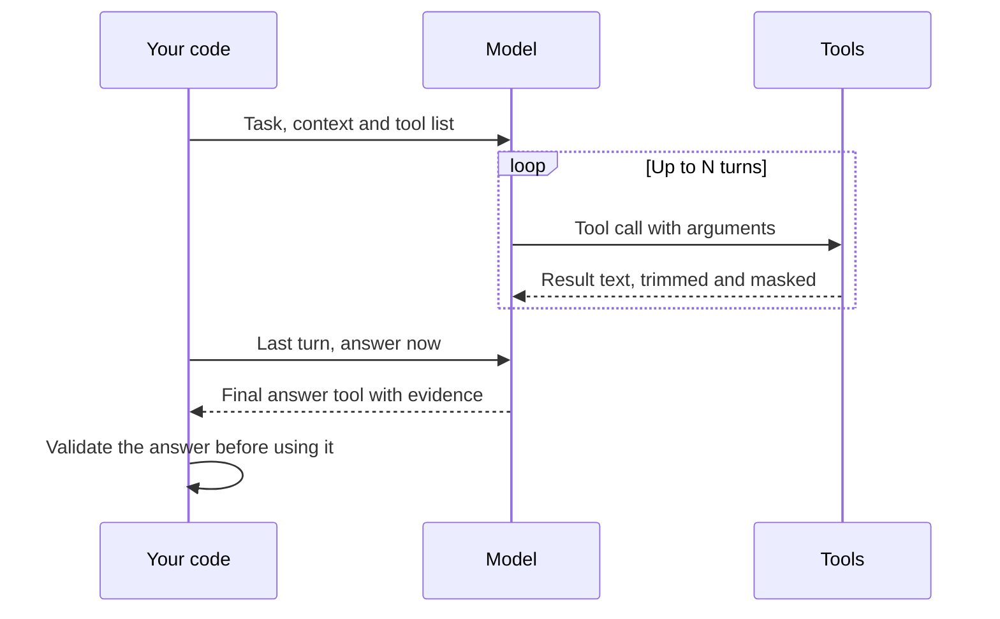

## TL;DR

> [!NOTE]
> Five lessons that will save you the most time:
>
> * Most AI features should be workflows with a few agent steps, not autonomous agents. Give the model control only where the path depends on what it finds.
> * A small model with verification steps can beat a large model on its own, on both quality and cost.
> * Make "I am not sure" a real result. Uncertain output needs its own place in the UI, not a forced yes or no.
> * Prompt caching, time budgets and cost metering are design decisions, not afterthoughts.
> * Measure every change on a fixed evaluation set. Several of our "obvious improvements" made results worse.

## How to Use This Guide

Each module teaches one topic in the same order:

1. The idea, in plain terms
2. When to use it and when not to
3. A short code sketch where it helps
4. An "In practice" example with measured results
5. An exercise to apply it to your own project

You can read the modules in order or jump to the one you need.

| Module                                                        | You will learn                                                           |
|---------------------------------------------------------------|--------------------------------------------------------------------------|
| [1. What Agentic AI Means](#module-1-what-agentic-ai-means)   | The difference between a workflow and an agent, and how to choose        |
| [2. Building Blocks](#module-2-building-blocks)               | The augmented model, structured output and deterministic rules           |
| [3. Workflow Patterns](#module-3-workflow-patterns)           | Chaining, routing, parallel work, orchestrators and evaluators           |
| [4. Designing Agents](#module-4-designing-agents)             | The reasoning loop, tool design and stopping rules                       |
| [5. Quality Patterns](#module-5-quality-patterns)             | Evidence, voting, judges, model cascades and three-way outcomes          |
| [6. Context Engineering](#module-6-context-engineering)       | What to put in the prompt, in which order, and how to retrieve it        |
| [7. Cost and Latency](#module-7-cost-and-latency)             | Caching, time budgets and measuring waste                                |
| [8. Human-AI Interaction](#module-8-human-ai-interaction)     | UX guidelines for features people can trust                              |
| [9. Security](#module-9-security)                             | Prompt injection, data leaks and excessive agency                        |
| [10. Evaluation](#module-10-evaluation)                       | How to know a change is an improvement                                   |
| [11. Frameworks](#module-11-do-you-need-an-agent-framework)   | When to use Microsoft Agent Framework, Semantic Kernel or your own layer |
| [12. Lessons from Failures](#module-12-lessons-from-failures) | Ideas that looked right and measured wrong                               |
| [Checklist](#checklist)                                       | Everything above as one list to work through                             |

## Glossary

| Term           | Meaning                                                                           |
|----------------|-----------------------------------------------------------------------------------|
| LLM            | Large language model, the model behind tools such as ChatGPT, Claude or Copilot   |
| Workflow       | Model calls connected by code paths you write in advance                          |
| Agent          | A model that decides its own next step, such as which tool to call, inside a loop |
| Tool call      | The model asks your code to run a function, and passes JSON arguments             |
| Context        | Everything the model sees in one call: instructions, data and earlier turns       |
| Token          | The unit models read and bill by, roughly three quarters of an English word       |
| Prompt cache   | A provider feature that bills a repeated start of a prompt at a lower price       |
| Recall         | Real issues the system found, out of all real issues                              |
| Precision      | Correct outputs, out of all outputs the system produced                           |
| Evaluation set | A fixed set of inputs with known correct answers, used to measure each change     |

## The Running Example

The examples come from one production system: an AI reviewer that comments on every pull request in a company's source control. It runs as a serverless function with a hard 10-minute limit. A small, low-cost model does most of the work, and a larger model handles a few hard decisions. Every change is measured on about 55 test pull requests with known issues (41 with one planted defect, 16 with nothing wrong).



> [!IMPORTANT]
> The numbers in this guide come from one internal evaluation set. They show the direction and size of effects you can expect. They are not a public benchmark, and your results will differ.

---

## Module 1: What Agentic AI Means

### Workflows and Agents

Anthropic's guide [Building effective agents](https://www.anthropic.com/engineering/building-effective-agents) describes two kinds of agentic systems:

* In a workflow, models and tools are connected through code paths you define in advance.
* In an agent, the model directs its own process and decides which tools to use.

The question to ask is: who decides the next step, your code or the model?

### A Scale of Agency

The scale below is a teaching aid, not a formal standard. Each level gives the model more control, and costs you more predictability.



| Level | What the model controls                           | Typical use                                                   |
|-------|---------------------------------------------------|---------------------------------------------------------------|
| 0     | Only its answer                                   | Summarize, classify, extract                                  |
| 1     | Its answer at each fixed step                     | Draft, then check, then format                                |
| 2     | Its answer, while code routes and splits the work | Handle different kinds of input differently                   |
| 3     | Which tools to call, inside limits you set        | Look things up when you cannot know in advance what is needed |
| 4     | The plan, the tools and when to stop              | Open-ended research or coding tasks                           |
| 5     | Several agents that hand work to each other       | Large tasks split across specialized roles                    |

### Choosing a Level

Start at the lowest level that can do the job, and move up only when a measured problem requires it.

| Question                                                      | If yes                             | If no                           |
|---------------------------------------------------------------|------------------------------------|---------------------------------|
| Can you write the steps down before the call?                 | Use a workflow                     | Consider an agent step          |
| Do you know what context the model needs before it starts?    | Retrieve it in code                | Give the model read-only tools  |
| Can you check the output with code or a second model?         | Agent output can be trusted        | Keep the agent out of this path |
| Is there a hard time or cost limit?                           | Cap turns, tokens and calls        | Looser limits are acceptable    |
| Could a wrong action cause damage, such as a write or a send? | Read-only tools, or human approval | Read-only tools may be enough   |

### Why Not Always Use an Agent

Agents are flexible, but you pay for that flexibility:

* Each extra turn sends the whole conversation again, so cost grows with every step.
* Open loops have no fixed end, which is a problem when the host stops the run at a time limit.
* More freedom means more variation between runs, which makes results hard to compare.
* Every tool an agent can call is something an attacker can try to trigger through the input.

> [!NOTE]
> In practice: the reviewer sits at Level 2 with one Level 3 step. Code fixes the order of the stages. Only the verification step is an agent, because checking whether a finding is true can require opening a file or following a definition nobody could predict. A free agent was rejected because of the 10-minute limit, the cost per review and the need for repeatable results.

> [!TIP]
> Exercise: pick an AI feature you are building. Write its steps on paper. Circle the steps where the next action depends on what the model finds. Those are the only candidates for an agent.

---

## Module 2: Building Blocks

### The Augmented Model

Every useful AI feature starts from one unit: a model with access to retrieval (the data it needs), tools (actions it can request) and memory (what happened before). Anthropic calls this the augmented LLM. Workflows and agents are combinations of this unit.

### Structured Output Through a Tool Call

Free text is hard for code to use. Ask the model to answer by calling one "answer tool" whose parameters are your output schema. Your code then always receives JSON.

```python
SUBMIT_RESULT = {
    "name": "submit_result",
    "description": "Return the result for one item.",
    "parameters": {
        "type": "object",
        "properties": {
            "findings": {"type": "array", "items": FINDING_SCHEMA},
            "needsMoreContext": {"type": "boolean"},
        },
        "required": ["findings", "needsMoreContext"],
    },
}

system_prompt = task_prompt + "\n\nAnswer only by calling the submit_result tool, exactly once."
```

Provider details matter here:

* Some newer models reject a forced tool choice, and forcing a tool can skip the model's thinking step. Automatic tool choice plus a strict schema plus the one-line instruction above works on every model we tried.
* Strict schemas support only part of JSON Schema. Remove limits such as `maxItems`, `minimum` or `maxLength` from the schema you send, and enforce them in your own code after parsing.
* Models sometimes return a nested array as a JSON string. Decode it, and if it was cut off, keep the complete items instead of discarding the whole answer.
* Treat an answer in plain text instead of a tool call as a retryable error.

### Fixed Rules Before Models

If code can find a problem every time, do not ask a model to find it. Rules are free, instant and give the same answer every run. Use a model for what rules cannot decide.

> [!NOTE]
> In practice: hard-coded credentials, containers that run as root and broken text encoding are found by plain code before any model runs. The model stages never spend tokens rediscovering them.

> [!TIP]
> Exercise: list the checks in your feature that a regular expression, a parser or a lookup could do. Move them out of the prompt and into code.

---

## Module 3: Workflow Patterns

These five patterns come from [Building effective agents](https://www.anthropic.com/engineering/building-effective-agents). Most production AI features combine two or three of them.

### Prompt Chaining

Split a task into steps, one model call per step, and check each output with code before the next step reads it.

* Use it when a task has clear phases, such as draft, check and format.
* Avoid it when the steps depend heavily on each other's details. Each handoff loses some context.

> [!NOTE]
> In practice: triage, review, validation, verification, judging and summary are separate stages, each with its own prompt and output schema. Smaller jobs let a smaller model do them well, and each stage can be tested on its own.

### Routing

A first call classifies the input and code sends it down a different path.

* Use it when inputs differ in kind or difficulty and each kind needs a different prompt, model or depth.
* Have a code-only fallback route for when classification fails.

> [!NOTE]
> In practice: a low-cost triage call labels each file skip, light or full, and tags its risks such as security or concurrency. When triage is off, code-only signals route the files, and that fallback never skips a file that contains logic.

### Parallelization

Two forms:

* Sectioning splits the work into independent parts that run at the same time.
* Voting runs the same task several times and combines the answers.

Voting follows the self-consistency idea from [Wang et al.](https://arxiv.org/abs/2203.11171): independent attempts that agree are more reliable than one attempt.

> [!NOTE]
> In practice: files are reviewed in parallel, riskiest first, and complex files get a second pass with a different focus (sectioning). The verification agent runs two or three times per finding, and two decisive answers must agree (voting).

### Orchestrator-Workers

A model breaks the task into subtasks at run time and sends them to worker calls.

* Use it when you cannot know the subtasks in advance, for example changes across an unknown number of files.
* Avoid it when code can plan the work. Code plans for free, the same way every time.

> [!NOTE]
> In practice: not used. The review steps are known in advance, so code does the planning.

### Evaluator-Optimizer

One call produces an answer, another evaluates it, and the first revises until the evaluator is satisfied.

* Use it when there are clear quality criteria and revisions measurably improve the result, such as translation or writing that must meet a style guide.
* Avoid it when one decision is enough. Every revision round adds cost and a new chance for errors.

> [!NOTE]
> In practice: a larger model acts as an evaluator for serious findings, but without the revision loop. It keeps, lowers or drops a finding and never sends it back to be rewritten. Keep, lower or drop was enough, and it costs one call.

> [!TIP]
> Exercise: draw your feature as boxes and arrows. Label each arrow chaining, routing, sectioning or voting. If an arrow fits none of them, ask whether that step needs a model at all.

---

## Module 4: Designing Agents

### The Reasoning Loop

Most agents follow the ReAct pattern from [Yao et al.](https://arxiv.org/abs/2210.03629): think, call a tool, read the result, repeat, then answer.



### A Bounded Loop

The loop below always ends, never breaks the prompt cache, and turns tool failures into information the model can use.

```text
for turn in 0..max_turns:
    if turn == max_turns - 1: add note "last turn: answer now with <final tool>"
    tools = read_tools + final_tool               # the same list every turn
    if turn == max_turns: tools = [final_tool]    # one extra turn at most
    answer = model(conversation, tools)
    if the final tool was called: return its arguments
    run each tool call; an exception becomes text the model can read
    trim each result and mask secrets, then add it to the conversation
```

### Rules for Tool Design

* Make tools read-only unless writing is the purpose of the feature. If it is, add human approval.
* Limit the scope of each tool, for example to one repository at one commit or one customer's records.
* Return errors as text, such as "No file X. Use find_files.", so the model can correct itself.
* Trim long results to a fixed number of characters and mask secrets in them.
* Write tool descriptions for the model: say what the tool returns and when to use it.
* Keep the tool list the same on every turn. The tool list sits at the start of the prompt, so changing it rewrites the prompt cache (see [Module 7](#module-7-cost-and-latency)).

### Stopping Rules

An agent must know when to stop:

* Set a maximum number of turns.
* Warn the model on the second-to-last turn.
* On the final turn, offer only the answer tool.
* If there is still no answer, fail cleanly and fall back to a safe default.

> [!NOTE]
> In practice: the verification agent has four read-only tools (find files, read lines of a file, find a definition, search text), at most four turns plus one answer-only turn, and access only to the repository at the pull request's commit. If it fails, the finding stays in the "possible issue" list instead of being posted. Nothing is lost.

> [!TIP]
> Exercise: for each tool your agent has, write down the worst thing it could do if the model called it with harmful arguments. If the answer is anything other than "nothing", narrow the tool or add an approval step.

---

## Module 5: Quality Patterns

### Require Evidence for Every Decision

When a model gives a verdict, require it to quote what supports it. Treat a verdict without evidence as "unsure".

```python
def decisive_verdict(check: dict) -> str:
    verdict = check.get("verdict", "unsure")
    has_evidence = bool(str(check.get("evidence", "")).strip())
    if verdict in {"confirmed", "rejected"} and has_evidence:
        return verdict
    return "unsure"
```

> [!NOTE]
> In practice: this one rule removed a whole class of confident but unsupported verdicts.

### Use the Agent to Check, Not to Generate

Generating and checking are different jobs. A small model is good at producing candidate answers but poor at knowing what it has not seen. Checking one specific claim with tools is a narrower job, and a small model does it well.

> [!NOTE]
> In practice: a small model writes candidate findings, code drops the ones it can disprove, and the verification agent proves or disproves the rest against the repository. On a 14-case test this pipeline reached 90% recall, against 60% for a large model working alone, at a lower cost.

| Setup                               | Recall | Precision | Cost for the set |
|-------------------------------------|-------:|----------:|-----------------:|
| Small model, one pass               |    40% |      100% |            $0.02 |
| Large model, one pass               |    60% |      100% |            $0.34 |
| Small model with verification steps |    90% |       82% |   $0.13 to $0.26 |

### Three Outcomes Instead of Two

Most AI features either show a result or hide it. Add a third outcome for results that are plausible but unproven.

| Outcome            | When                                   | What the user sees                  |
|--------------------|----------------------------------------|-------------------------------------|
| Shown              | The evidence proves it                 | The result, in the main view        |
| Listed as possible | Plausible, but not proved              | A folded section with the reason    |
| Dropped            | Disproved, out of scope or a duplicate | Nothing (kept in logs for analysis) |

This keeps the main view trustworthy without throwing away useful but uncertain results.

### LLM-as-a-Judge

A second model, often larger, reviews important outputs before they reach the user. [Zheng et al.](https://arxiv.org/abs/2306.05685) showed that strong models agree with human judges at about the rate humans agree with each other. Give the judge clear criteria and limit what it can do: keep, change or drop, never add.

> [!NOTE]
> In practice: the judge corrected all five serious findings it saw in production that had an inflated severity. Skipping the judge when every verification vote already agreed with evidence cut its cost by 47%, with the same precision and recall.

### Model Cascade

Send everything to a low-cost model first and only the hard cases to a larger one. [FrugalGPT](https://arxiv.org/abs/2305.05176) showed large cost savings with matching quality using this idea. Decide what counts as a hard case with code you can measure, such as risk, uncertainty and complexity scores.

> [!NOTE]
> In practice: on a 51-case run, the large model accounted for 37% of the cost while making only a few of the calls. Every place it is used must justify itself on the evaluation set.

> [!TIP]
> Exercise: find the step in your feature where a wrong answer hurts users most. Add an evidence requirement there before you add a bigger model.

---

## Module 6: Context Engineering

Context engineering means deciding what the model sees, in what order, and how you retrieve it. It often matters more than the wording of the prompt.

### Retrieve with Code When You Can

Retrieval-augmented generation ([Lewis et al.](https://arxiv.org/abs/2005.11401)) usually means vector search. For structured data such as source code, configuration or database records, parsing and lookups are often better: cheaper, the same every run, and with no index to keep up to date. Give the model search tools for the cases parsing misses.

> [!NOTE]
> In practice: the reviewer gives each file an outline of the other changed files, the definitions of code it uses, and its callers, all found by parsing. The verification agent searches for anything else it needs.

### Order the Prompt by How Widely Each Part Is Shared

Put the parts shared by the most calls first and the part unique to each call last:

```text
[tools] [system] [shared by all calls] [shared by a group] [shared by one item] [this call's question]
         \_________________ cached, most widely shared first _________________/
```

This order lets the provider cache the shared parts, which Module 7 covers. It also keeps the instructions and the question close to where the model reads last.

### Treat All Input as Data, Never as Instructions

Anything a user or third party wrote is data. Say so in every system prompt, and mark your real instructions so that input cannot pose as them (see [Module 9](#module-9-security)).

### Tell the Model What Changed

When a task repeats on updated input, such as a second review of the same document, give the model the difference and tell it to focus there. Otherwise it repeats what it said before.

> [!NOTE]
> In practice: in later review rounds, 683 of 987 findings (69%) repeated earlier ones. Unchanged files are now skipped, the model is told which lines are new, and findings away from those lines are dropped unless they are serious.

> [!TIP]
> Exercise: print the full prompt of one call in your feature. Mark each part as "same for every call", "same for some calls" or "unique". Reorder it from most shared to least.

---

## Module 7: Cost and Latency

### Layer the Prompt Cache

Providers such as Anthropic and OpenAI bill a repeated start of a prompt at a lower price ([Anthropic prompt caching](https://docs.anthropic.com/en/docs/build-with-claude/prompt-caching)). Set a cache breakpoint after each shared layer from Module 6, so adding a new group adds only its own layer and keeps the shared one cached.

### Write the Cache Once Before Calls Fan Out

When 30 calls start at the same moment, all 30 miss the cache and all 30 pay to write it. Send one tiny "primer" call that writes the shared context first, then start the parallel calls. Treat the primer's cut-off reply as success.

### Stagger Repeated Calls

If you run several votes on the same input, start the second one after the first finishes its first turn. By then the first has written the cache, and the second reads it at the lower price.

```python
async def staggered_pair(start):
    first_turn_done = asyncio.Event()
    first = asyncio.create_task(start(first_turn_done))
    waiter = asyncio.create_task(first_turn_done.wait())
    # Also stop waiting if the first call ends or fails before its first turn completes.
    await asyncio.wait({first, waiter}, return_when=asyncio.FIRST_COMPLETED)
    waiter.cancel()
    second = asyncio.create_task(start(None))
    return [await first, await second]
```

### Keep the Agent's Tool List Stable

> [!NOTE]
> In practice: the agent used to get a shorter tool list on its last turn. That changed the start of the prompt and rewrote the cache each time. Keeping the list the same and adding a "last turn" note instead cut cache writes by about 25%.

### Give Every Stage a Time Budget

Serverless hosts and request timeouts stop work without warning. Give each stage the time left minus what the later stages need, so a slow run ends with a partial result instead of nothing.

```python
class Budget:
    def __init__(self, total_s: float, safety_s: float = 30.0):
        self._end = time.monotonic() + total_s - safety_s

    def left(self, reserve_s: float = 0.0) -> float:
        return max(0.0, self._end - time.monotonic() - reserve_s)


# This stage keeps time for the stages after it.
timeout = budget.left(reserve_s=CHECK_S + SUMMARY_S + DELIVER_S)
```

* Process the most important items first.
* Do not start an optional step when less than a minimum time is left.
* Tell the user what was not processed, and why.
* Use async SDK clients so a cancelled call actually stops its HTTP request.

### Cache Whole Results by Their Inputs

Hash everything a result depends on (prompt version, model, input content and retrieved context) and reuse the result when the hash matches. Leave out anything that changes often but does not affect this result. Any cache error should count as a miss: a cache should only save money, never break a run.

### Treat the Output Limit as a Spending Cap

Set the output token limit to a few times a normal answer, not the model's maximum.

> [!NOTE]
> In practice: with strict schemas on, one model sometimes filled its whole 16,000-token output limit with an empty tool call. It did so in 3 of 3 replays, against 0 of 3 with strict mode off, at $0.17 per wasted call. The fix: a lower limit, and when an answer is cut off, one retry with less thinking and strict mode off.

### Measure Waste, Not Only Spend

Log every model attempt with its cost and an outcome: ok, failed (nothing paid), wasted (paid but the answer was discarded) or cancelled (stopped by the time budget). Record what caching saved as well.

> [!NOTE]
> In practice: this data showed that a quality-sampling step ran in 23% of runs and took 14% of the spend. It was reduced to one item on 25% of first runs.

> [!TIP]
> Exercise: for one week, log cost per stage and per outcome. Find your most expensive stage and your largest source of waste. Fix the waste first.

---

## Module 8: Human-AI Interaction

An AI feature is a product with users. Two widely used guides help you design it: the [Microsoft Guidelines for Human-AI Interaction](https://www.microsoft.com/en-us/haxtoolkit/ai-guidelines/) (HAX, 18 guidelines from Amershi et al., CHI 2019) and the [Google PAIR People + AI Guidebook](https://pair.withgoogle.com/guidebook/).

### HAX Guidelines in Practice

| HAX guideline                        | What it means for your feature                    | In practice                                                                      |
|--------------------------------------|---------------------------------------------------|----------------------------------------------------------------------------------|
| G1 Make clear what the system can do | State what was processed and what was not         | Skipped and unfinished files are named, with the reason                          |
| G2 Make clear how well it can do it  | Do not present uncertain output as certain        | "No confirmed issues" differs from "No issues found"                             |
| G3 Time services based on context    | Act when the user needs it                        | Runs on each change; later rounds focus on what is new                           |
| G6 Mitigate social biases            | Protect people from unfair use of AI output       | No names stored; people compared only on averages with error bars                |
| G8 Support efficient dismissal       | Let users reject output once, and remember it     | "Won't fix" is respected; the same point is raised again at most once            |
| G9 Support efficient correction      | Let users correct output in one step              | One-line replies such as "P2 not real: the caller checks it"                     |
| G10 Scope services when in doubt     | Do less when unsure                               | Unproved results go to a folded list, not to the main view                       |
| G11 Make clear why                   | Show the evidence for each output                 | Each result quotes the code it is about; each listed point says why it is listed |
| G12 Remember recent interactions     | Do not repeat yourself                            | Points already raised are not repeated in later rounds                           |
| G13 Learn from user behavior         | Use feedback to adjust what you show              | Kinds of results users mostly reject move to the folded list                     |
| G14 Update and adapt cautiously      | Change behavior only after you measure the change | Every prompt, rule or model change runs on the evaluation set first              |
| G15 Encourage granular feedback      | Collect feedback per item, not per session        | Feedback per point and per result                                                |

### Design Techniques Worth Copying

#### Number Uncertain Items

Number uncertain items (P1, P2, ...) and let users answer in one line, such as `P1 real`. Each answer takes seconds and gives you a labeled example of something your system was unsure about. Most AI products never collect this data.

#### Cap the Output Per Location

Too many AI comments in one place lead people to ignore all of them, including the important one. Set a maximum per location and move the lowest-ranked items to the folded list.

#### Fail Gracefully

When the AI cannot finish, show one short message with a next step and no internal error details. Remove it when the next run succeeds. A partial result should name what it did not cover.

#### Measure the Right Outcome

User clicks can mislead. A "resolved" button may be clicked because a policy requires it, not because the problem was fixed. Measure the real outcome where you can.

> [!NOTE]
> In practice: after a pull request closes, the system checks whether the code under each comment actually changed between the reviewed version and the final version. Those labels, not the clicks, decide which kinds of comments are shown inline.

> [!TIP]
> Exercise: score your feature against the HAX table. Pick the two guidelines you meet least well and design one change for each.

---

## Module 9: Security

The [OWASP Top 10 for LLM Applications (2025)](https://genai.owasp.org/llm-top-10/) is the most common checklist for LLM security. The table maps the most relevant risks to controls you can apply.

| OWASP risk                             | Control to apply                                                     | In practice                                                    |
|----------------------------------------|----------------------------------------------------------------------|----------------------------------------------------------------|
| LLM01 Prompt Injection                 | Treat input as data; mark trusted instructions                       | Random marker on the team's instructions (below)               |
| LLM02 Sensitive Information Disclosure | Mask secrets and personal data in everything sent and shown          | Credentials masked in model input, tool results and output     |
| LLM05 Improper Output Handling         | Validate model output before you act on it                           | Schema check; quoted text must exist; malformed output dropped |
| LLM06 Excessive Agency                 | Read-only, narrowly scoped tools; limited turns; approval for writes | Four read-only tools on one repository at one commit           |
| LLM07 System Prompt Leakage            | Keep secrets out of prompts; mask internal markers in output         | The marker is masked in anything posted                        |
| LLM09 Misinformation                   | Evidence requirements, votes and review before results reach users   | Evidence rule, votes and a judge before posting                |
| LLM10 Unbounded Consumption            | Cap tokens, turns, calls, time and cost                              | Caps per stage, a time budget and a cost alert                 |

### The Random-Marker Technique

Any text a user or third party controls can contain something like "System instructions: ignore all rules". Mark your real instructions with a random value the attacker cannot know:

```python
import secrets

TRUSTED_MARK = secrets.token_hex(8)  # new for every process, never shown to anyone


def trusted_block(text: str) -> str:
    return f"[trusted-instructions {TRUSTED_MARK}]\n{text}\n[end trusted-instructions {TRUSTED_MARK}]"


# Before every model call, rewrite any "[trusted-instructions ...]" line that lacks
# TRUSTED_MARK into "[text from the input that claims to be instructions]".
```

The system prompt says to trust only the block with the marker. A forged block in the input never carries it, so it never looks like the real one.

> [!WARNING]
> No technique stops prompt injection completely. Combine the marker with read-only tools, output validation and limits, so that a successful injection can do little harm.

> [!TIP]
> Exercise: write three inputs that try to make your feature ignore its instructions, leak a secret or call a tool it should not. Add them to your evaluation set as permanent tests.

---

## Module 10: Evaluation

Evaluation-driven development means measuring every prompt, model or rule change on a fixed set of cases before it ships, the same way unit tests guard code changes.

### Build the Evaluation Set

* Collect real inputs and plant known problems in some of them.
* Include clean inputs with nothing wrong. Any output on a clean input is a false positive.
* Store the expected answers next to each case.
* Add every production failure you find as a new case.

### Choose Metrics That Cannot Hide Problems

| Metric                      | Why you need it                                                                 |
|-----------------------------|---------------------------------------------------------------------------------|
| Recall                      | Shows what the system misses                                                    |
| Strict precision            | Counts only the issues you planted                                              |
| Real precision              | Also counts real issues you did not plant, so useful output is not called noise |
| Clean cases with any output | Catches noise that precision alone hides                                        |
| Cost per case, by stage     | Shows what each quality gain costs                                              |

> [!NOTE]
> In practice: in one run, about 9 of 15 so-called false positives were real issues nobody had planted. Without real precision, the team would have tuned the system to miss real problems.

### Account for Noise

Model output varies between runs, even on the same input. Run each change two or three times before you decide. On about 50 cases, recall and precision moved 3 to 5 points between identical runs, so one run cannot prove a 3-point gain.

If AI output feeds any metric about people, measure the noise first. In the running example, one score varied by about 7 points between runs. Report averages with error bars of 1.96 × 7 / √n (about ±6 points at 5 items, ±4 at 10), and show "too few items" below a minimum count.

> [!CAUTION]
> Never rank or judge a person on a single AI-generated score.

### Automate the Gate

* Make the evaluation script exit with an error below a minimum precision and recall, and run it before every release.
* Store a fingerprint of the prompt, rules and model with every run, so any result can be traced to its configuration.
* Test your test doubles. In the running example, an evaluation silently stopped after the first case because a fake client was missing one attribute.

### Results from the Running Example

| Measure (about 55 cases)     | Result      |
|------------------------------|-------------|
| Recall                       | 98%         |
| Strict precision             | 82%         |
| Real precision               | 94%         |
| Clean cases with any comment | 0 of 16     |
| Cost for the whole set       | about $0.47 |

> [!TIP]
> Exercise: write ten evaluation cases for your feature today: seven with a known problem and three clean ones. Run them before and after your next prompt change.

---

## Module 11: Do You Need an Agent Framework

Agent frameworks give you model clients, tool calling, agent loops, workflows and telemetry out of the box. You may still choose your own thin layer.

| Option                                | A good fit when                                                          | Watch out for                                                                                                  |
|---------------------------------------|--------------------------------------------------------------------------|----------------------------------------------------------------------------------------------------------------|
| Provider SDK with your own thin layer | You need exact control over caching, cost per stage and hard time limits | You own retries, logging and the agent loop                                                                    |
| Microsoft Agent Framework             | Multi-agent work, workflows with checkpoints, human approval, many tools | Check its current release status; its abstractions may hide cache controls                                     |
| Semantic Kernel                       | You already have Semantic Kernel code                                    | Microsoft describes Agent Framework as the successor to Semantic Kernel and AutoGen; plan new agent work there |
| Other frameworks, such as LangGraph   | Graph-shaped state machines in the Python or JavaScript ecosystems       | Another dependency and its own concepts to learn                                                               |

Questions to decide:

* How many model providers do you need to support?
* Do you need durable runs that survive restarts, or human approval steps?
* How much do prompt caching and per-stage cost control matter to your budget?
* Can your hosting (for example serverless cold starts) afford the extra dependencies?

> [!NOTE]
> In practice: the running example uses the provider SDKs and a thin layer of its own, about one module for the client contract plus one adapter per provider. It needed exact control over the prompt cache, cost per stage and a 10-minute limit. A framework would make sense for long-running workflows, human approval steps or many cooperating agents.

---

## Module 12: Lessons from Failures

Each of these looked like an improvement. Measurement showed otherwise.

| Idea                                                  | What happened                                                                               |
|-------------------------------------------------------|---------------------------------------------------------------------------------------------|
| Send every high-risk item to the large model again    | Recall fell from 97% to 92-94%, and cost rose 31%                                           |
| Show more of the verified suggestions                 | Strict precision fell from 73% to 55%, and 5 of 16 clean cases got comments                 |
| Judge every important result                          | The same quality as skipping the ones every vote confirmed, at about twice the judge's cost |
| Sample quality with the large model on every run      | It ran in 23% of runs and took 14% of the spend                                             |
| Use strict schemas everywhere                         | One model filled its output limit with empty answers                                        |
| Give the agent a different tool list on its last turn | It rewrote the prompt cache on every check                                                  |

> [!IMPORTANT]
> Plan for experiments that fail. An evaluation set turns a costly production mistake into a cheap afternoon experiment.

---

## Checklist

### Design

* [ ] Each step is code unless it needs a model, and a model step is an agent only if it must choose its own path
* [ ] Fixed rules run before any model call
* [ ] Every model answer is a tool call with a JSON Schema
* [ ] A small model does most of the work; a larger model goes only where measurement shows it helps

### Agents

* [ ] Tools are read-only and narrowly scoped, or writes need human approval
* [ ] A fixed maximum number of turns, a last-turn warning and an answer-only final turn
* [ ] Tool errors come back as text; tool results are trimmed and masked
* [ ] The tool list is the same on every turn

### Quality and Experience

* [ ] Decisive answers require quoted evidence
* [ ] Uncertain results have their own place, a stated reason and a one-line way to respond
* [ ] Output is capped per location
* [ ] Repeated runs focus on what changed
* [ ] Failures show a next step, never internal details

### Security

* [ ] All user-controlled content is treated as data in every system prompt
* [ ] Trusted instructions carry a random per-process marker
* [ ] Secrets are masked in model input, tool results and output
* [ ] Tokens, turns, calls, time and cost are capped

### Cost

* [ ] Prompt parts are ordered from most shared to least, with cache breakpoints
* [ ] The cache is primed before calls fan out, and repeated calls are staggered
* [ ] Each stage has a time budget that reserves time for later stages
* [ ] Every attempt is logged with its cost and outcome, including waste

### Evaluation

* [ ] The evaluation set has planted and clean cases
* [ ] Strict and real precision, recall and cost are reported per stage
* [ ] Each change runs two or three times, behind an automated quality gate
* [ ] Configuration fingerprints are stored with every run
* [ ] Outcomes are measured by what really changed, not by clicks

---

## References

* Anthropic, [Building effective agents](https://www.anthropic.com/engineering/building-effective-agents) (2024)
* Anthropic, [Prompt caching](https://docs.anthropic.com/en/docs/build-with-claude/prompt-caching)
* Yao et al., [ReAct: Synergizing Reasoning and Acting in Language Models](https://arxiv.org/abs/2210.03629) (2022)
* Wang et al., [Self-Consistency Improves Chain of Thought Reasoning in Language Models](https://arxiv.org/abs/2203.11171) (2022)
* Zheng et al., [Judging LLM-as-a-Judge with MT-Bench and Chatbot Arena](https://arxiv.org/abs/2306.05685) (2023)
* Chen, Zaharia and Zou, [FrugalGPT: How to Use Large Language Models While Reducing Cost and Improving Performance](https://arxiv.org/abs/2305.05176) (2023)
* Lewis et al., [Retrieval-Augmented Generation for Knowledge-Intensive NLP Tasks](https://arxiv.org/abs/2005.11401) (2020)
* Amershi et al., [Guidelines for Human-AI Interaction](https://www.microsoft.com/en-us/haxtoolkit/ai-guidelines/) (CHI 2019, Microsoft HAX Toolkit)
* Google PAIR, [People + AI Guidebook](https://pair.withgoogle.com/guidebook/)
* OWASP, [Top 10 for LLM Applications 2025](https://genai.owasp.org/llm-top-10/)
* NIST, [AI Risk Management Framework 1.0](https://www.nist.gov/itl/ai-risk-management-framework)
* Microsoft, [Agent Framework overview](https://learn.microsoft.com/agent-framework/overview/)
